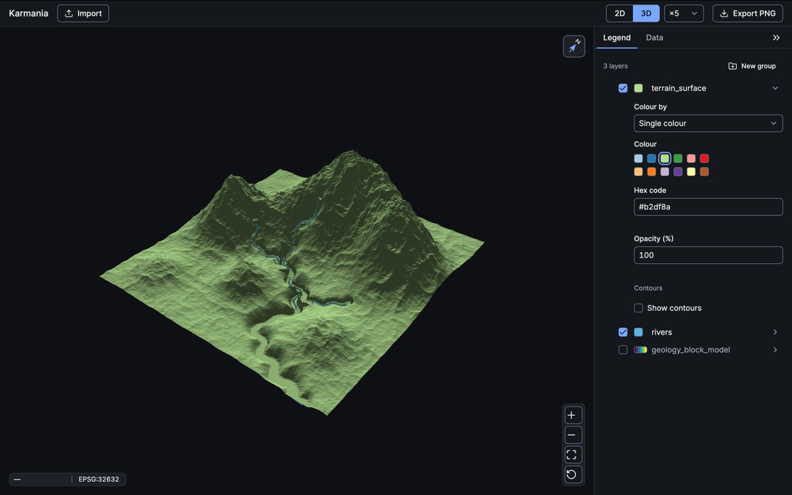

<h1 align="center">Karmania sample datasets</h1>

  <b>Data to try in <a href="https://github.com/SupernovifieD/karmania-map-viewer">Karmania</a>, an open-source engine for geoscience map data.</b> 
  Every sample is a folder: the files, a README that says what each file is and how to bring it into Karmania, and the script that made it when it was made by one.

 

## Samples

<table>
  <tr>
    <td width="40%" valign="top">
      
    </td>
    <td width="60%" valign="top">
      <h3><a href="synthetic-mountains/">Synthetic mountains</a></h3>
      A made-up mountain region of 30 km by 30 km, in UTM zone 32N (EPSG:32632), with three mountains, a river with two tributaries and six rock units. It holds one file of every shape Karmania draws in 3D and 2D: a <b>block model</b> of 248,507 blocks, <b>lines</b> (the rivers), a <b>mesh</b> (the terrain) and two <b>grids</b> (the height of the ground and the rock at the surface).
        
      Use it to see the whole of Karmania on one dataset: a geology block diagram in 3D, contour lines from the mesh, a geological map in 2D, and an exported picture. It is invented, not a real place: the numbers mean nothing outside the demonstration.
        
      <b>Size:</b> 14 MB in 10 data files and the generator, of which the block model is 10.7 MB.
    </td>
  </tr>
</table>

 

## How to use a sample

1. **Get the files.** Clone the repository with `git clone --depth 1 https://github.com/SupernovifieD/karmania-map-viewer-sample-datasets.git`, or use *Code* then *Download ZIP* on this page, or open one file here and download it with the *Download raw file* button. Keep a data file together with the `.prj` of the same name: it says which coordinate system the data is in.
2. **Run Karmania.** There is no hosted version yet. [Setting up](https://github.com/SupernovifieD/karmania-map-viewer#setting-up) in its README says how to run it on your computer.
3. **Import.** Press *Import*, and choose the data file **and** its `.prj` at the same time. The wizard suggests what each column is; each sample's README says what to choose where the wizard cannot know.

## Adding a sample

A sample is a folder with:

- the data files, each with a `.prj` beside it (so that the coordinate system is never a guess),
- a `README.md` with what each file is, what Karmania makes of it (its shape), and how to bring it in,
- the script that made it, if one did, and a statement of where real data comes from and under which licence it may be used,
- a line with its size, so that nobody downloads 100 MB by surprise.

Then add a row to the table above, with a picture of the sample in Karmania.

## Licence

The scripts and the invented data they make are under the Apache License 2.0: see [`LICENSE`](LICENSE). A sample that holds real data says in its README where it comes from and under which licence.
