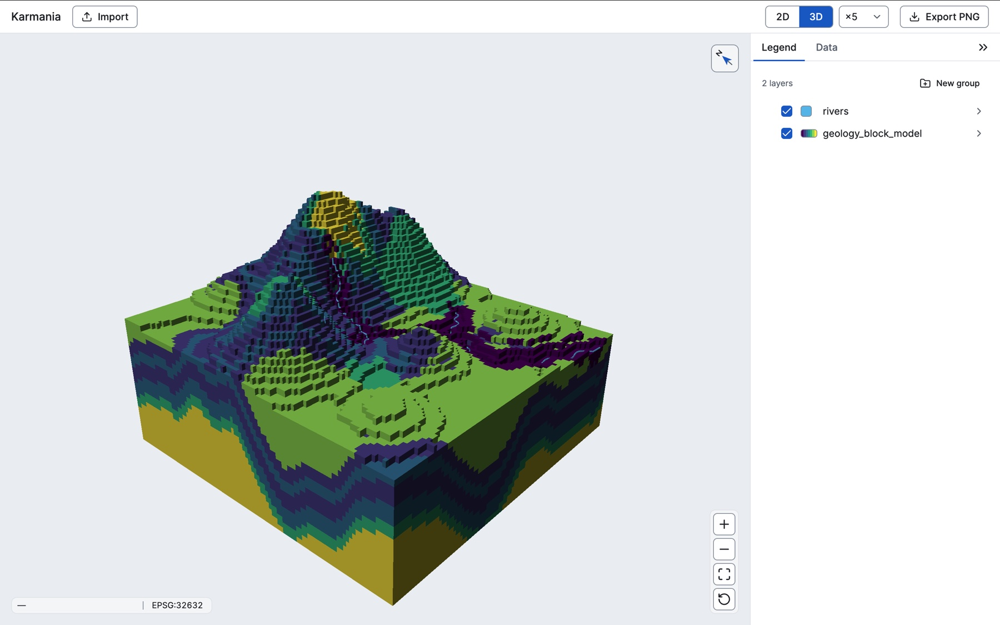
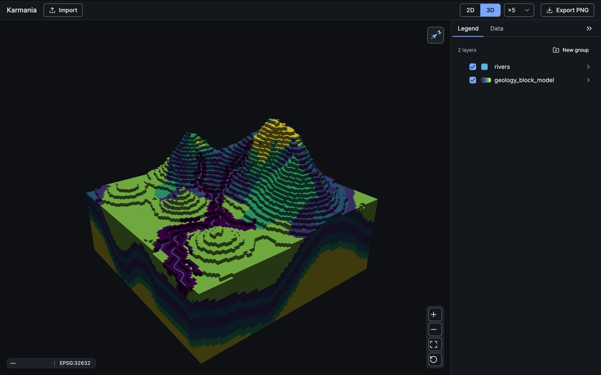
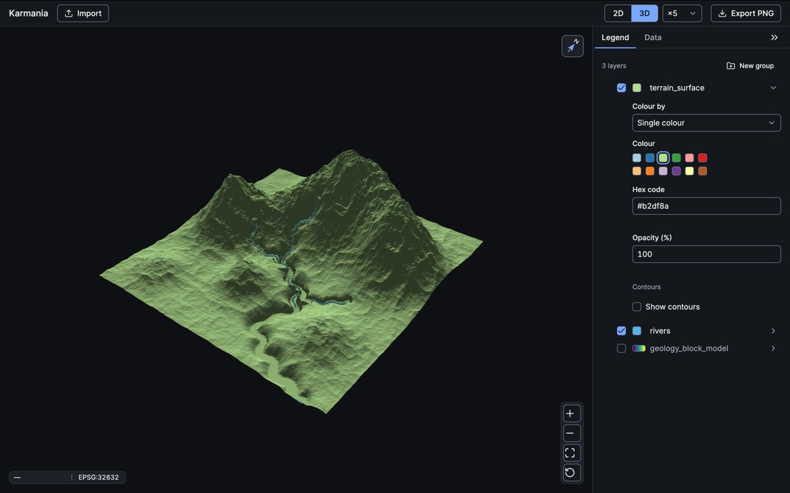
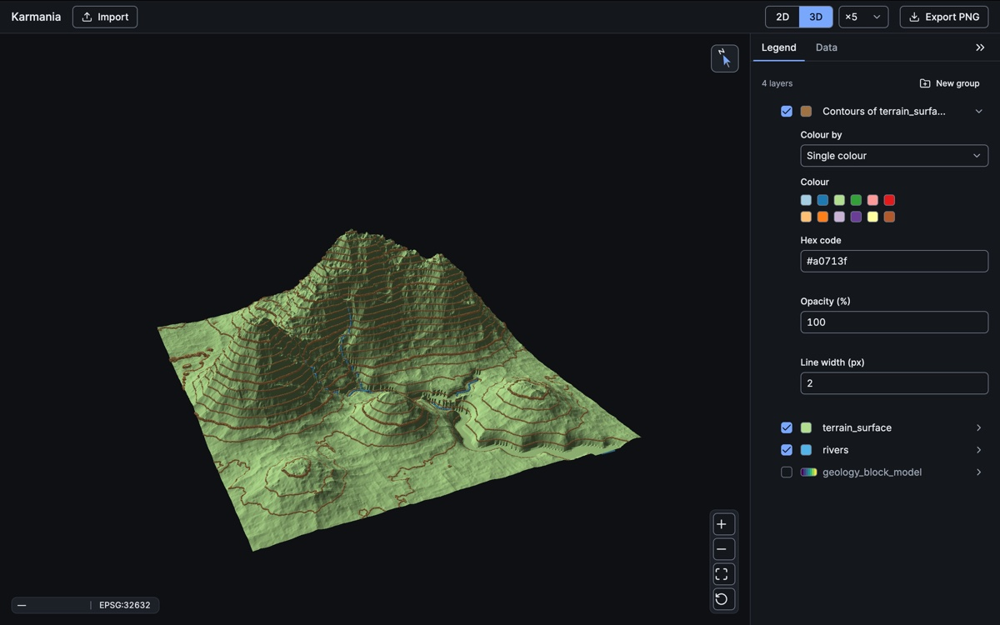

# Synthetic mountains

**Everything in this folder is invented by formulas** (`make_mountains.py`). It is not a real place, a survey or a geological model, and it must not be used as one. It is made to look like a geological block diagram: a 30 km × 30 km region with three mountains, several hills, a river with two tributaries, six rock units on the surface, and folded layers in the walls. It sits in UTM zone 32N (EPSG:32632) at E 480,000 to 510,000 and N 5,150,000 to 5,180,000, a position chosen only so that the coordinates are in metres.

Ground elevations run from 30 m to 2,462 m (the main summit); the block model goes down to −1,800 m. All together the folder is 14 MB, and 10.7 MB of that is the block model.

<table>
  <tr>
    <td width="50%" valign="top">
      
      <br>
      <sub>The block model and the rivers in 3D, light theme, with the heights exaggerated five times.</sub>
    </td>
    <td width="50%" valign="top">
      
      <br>
      <sub>The same view in the dark theme, from another side.</sub>
    </td>
  </tr>
  <tr>
    <td width="50%" valign="top">
      
      <br>
      <sub>The smooth ground, from <code>terrain_surface.obj</code>, with the rivers.</sub>
    </td>
    <td width="50%" valign="top">
      
      <br>
      <sub>Contour lines made by Karmania from the mesh, drawn over it.</sub>
    </td>
  </tr>
</table>

## Files

| File | Karmania shape | What it is |
| --- | --- | --- |
| `geology_block_model.csv` + `.prj` | **Block model** (3D volume) | 248,507 blocks of 300 × 300 m × 100 m, from −1,800 m up to the ground. One block per row: centre `XC`, `YC`, `ZC`, the rock `unit` (a category), `unit_code` (1 to 6) and `depth_m` (depth of the block centre below the ground). **This is the one that gives the block diagram.** |
| `rivers.csv` + `.prj` | Lines (3D) | The main river and two tributaries, 397 points, `Line` 1 to 3. Their `Z` is the top of the block under them plus 10 m, so they lie on the stepped surface of the blocks. |
| `terrain_surface.obj` + `.prj` | Mesh (3D) | The smooth ground: 40,401 vertices (150 m apart), 80,000 triangles. |
| `terrain_dem.asc` + `.prj` | Grid (2D) | The height of the ground, 300 × 300 cells of 100 m. |
| `surface_geology.asc` + `.prj` | Grid (2D) | The rock unit at the surface as a code 1 to 6, on the same cells. |
| `make_mountains.py` | (code) | The generator: see [Making it again](#making-it-again). |

Every `.prj` says WGS 84 / UTM zone 32N, EPSG:32632.

## The six units

| Code | Unit | Blocks | Share of the surface |
| --- | --- | --- | --- |
| 1 | Alluvium & Sediments | 1,811 | 13% (along the rivers) |
| 2 | Sedimentary Rocks | 35,272 | 22% |
| 3 | Volcanic Rocks | 37,728 | 15% |
| 4 | Igneous Intrusions | 33,345 | 10% (two bodies; the big one is on the east mountain's flank) |
| 5 | Metamorphic Rocks | 16,430 | 38% (the lowlands) |
| 6 | Basement Rock | 123,921 | 2% (the rocky summits of the main and west mountains) |

A stack of layers rests on a "basement" surface that rises under each mountain, so the layers arch over the mountains and show up as rings on their flanks, with the oldest rock at the top of the mountains. Two intrusions cut through the layers, and alluvium lies on the valley floors along the rivers (only where it is at least 15 m thick). The walls of the block show the layers folded, because the basement surface also has broad waves.

## To see the block diagram in 3D

1. Press **Import**, and choose `geology_block_model.csv` and `geology_block_model.prj` at the same time. The wizard suggests **Block model** and the columns `XC`, `YC` and `ZC`. At the size of a block enter **300, 300 and 100**. The file has no no-data values.
2. Switch the toolbar to **3D**, and set the exaggeration of heights (the menu beside it) to **3 or 5**: the region is 30 km wide and 2.5 km high, so at ×1 it looks flat and at ×10 the mountains are very steep.
3. Open the layer in the **Legend** and choose what to colour by. `unit` is a category, so each rock unit gets its own colour and the legend lists the unit names; `unit_code` is a number, so it can be sorted into classes along a colour ramp, as in the pictures above.
4. Import `rivers.csv` as **Lines** (`X`, `Y`, `Z` and `Line` are suggested) and give it a blue colour: the rivers then run along the valleys.
5. Orbit round it: the walls of the block show the folded layers, and the top shows the units where they reach the ground.

**What it will not look like:** Karmania draws blocks as boxes, so the ground is a staircase of 100 m steps and not a smooth surface; there is no snow, texture or water.

## Other ways to look at it

- **Smooth mountains:** import `terrain_surface.obj` *instead of* the blocks (not with them: the two surfaces cut through each other). Use 3D and an exaggeration of 3 to 5; it is one colour, shaded by the light. In the layer's settings, **Show contours** makes contour lines from the mesh at the interval you choose, as in the last picture above.
- **2D maps:** use the grids in the 2D view. Import `terrain_dem.asc` and colour it by value (or make contours from it), and `surface_geology.asc` in **6 equal-interval classes**: each class is one unit (1 to 6 in the table above; the legend shows the number ranges, not the names). A grid is the way to get a geological map in 2D; the blocks are for 3D.
- **Together:** everything is in the same coordinate system, so all the files can be loaded at once. In 3D, show the blocks *or* the mesh (not both), with the rivers, and keep the grids for 2D.
- **A picture to keep:** *Export PNG* writes the map with its legend, north arrow and (in 2D) scale bar.

## Making it again

`make_mountains.py` is pure Python standard library, and has no randomness: it makes exactly these files every time.

```
python3 make_mountains.py some-folder
```

It writes the ten data files into `some-folder`. The settings are the constants near the top of the file: the size of the region (`W`), the size of a block (`BLOCK`), the bottom of the model (`Z_BOTTOM`), `SEED`, the peaks, the river, the stack of layers and the intrusions. Change them and run it again to make a variation. The SHA-256 of the files in this folder, to check that your copy is the same:

| File | Bytes | SHA-256 |
| --- | ---: | --- |
| `geology_block_model.csv` | 10,753,284 | `f12d7bb73bc3985a7a9527da4db8b31cb963f0edb742dfa73f96de6c06ec783a` |
| `rivers.csv` | 13,893 | `bc0510711567e54aca48e55328b25687292024698e72d7f68c9e16358a742042` |
| `surface_geology.asc` | 180,087 | `94d8de7d5fb51e1f1f95561f43a6352aec058020d8054618ff4d73998a34a311` |
| `terrain_dem.asc` | 648,458 | `fc9fe26dec1ae97f343689d13c3348337eda7b2e3c435123a771681b4215f738` |
| `terrain_surface.obj` | 2,674,667 | `1ecaf2c2959149357958ffd48d7af77b4c77bc193527f0b995fe5fb1fee3c34b` |
| the five `.prj` files (all the same) | 596 each | `39cd37e772401a497d415520938ec48a028690ddba674850f060b3652b22d037` |

## What the files hold, and how it was checked

- **Blocks:** 248,507 rows, every centre on the 300 × 300 × 100 m lattice, with 6 distinct units (the counts are in the table above).
- **Rivers:** 3 lines in 397 points (268, 65 and 64).
- **Mesh:** 40,401 vertices and 80,000 triangles.
- **Grids:** 300 × 300 cells of 100 m with the corner at E 480,000, N 5,150,000, and no-data value −9999 in the header; ground 30 to 2,462 m.
- **Karmania's import:** every file was loaded through Karmania's own import engine (the WebAssembly kernel) together with its `.prj`: all five load with no findings, the coordinate system is read from the `.prj` as EPSG:32632, and the shapes and counts are the ones above.
- **The generator** run again gave the same SHA-256 for all ten data files.

Limits: the 100 m steps and the 300 m blocks are coarse next to the thin layers (200 to 650 m thick), so the layer boundaries are jagged; the geology obeys simple rules and has none of the detail of a real map; the model is sparse (blocks only up to the ground), so Karmania draws every face of every block, and the 3D view may be slow on a modest computer.

## Licence

The generator and the data it makes are under the Apache License 2.0, as the rest of this repository: see [`LICENSE`](../LICENSE).
